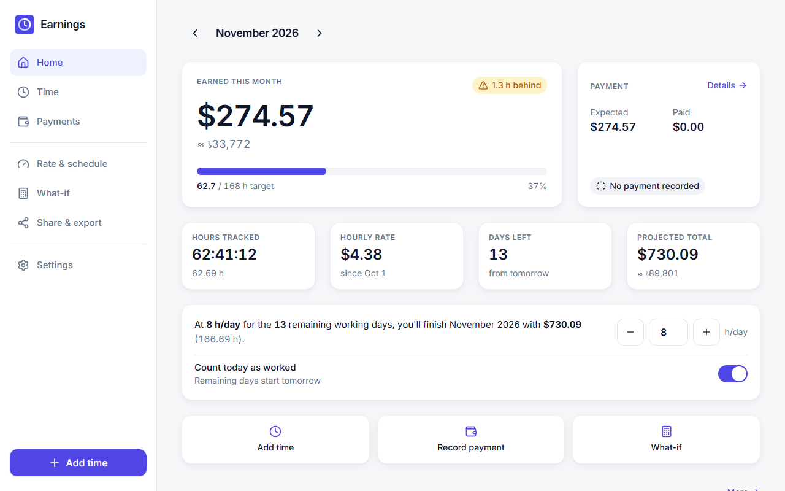
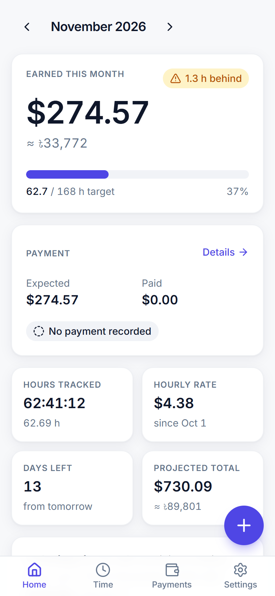
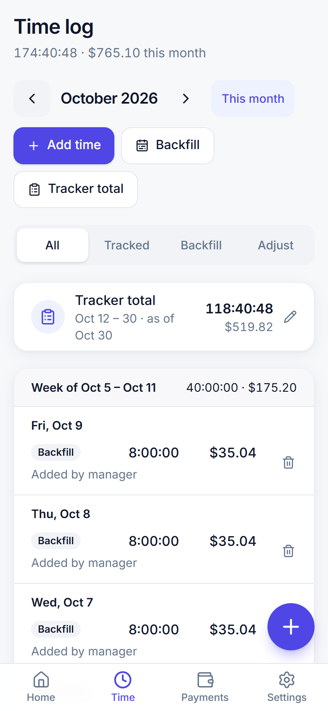
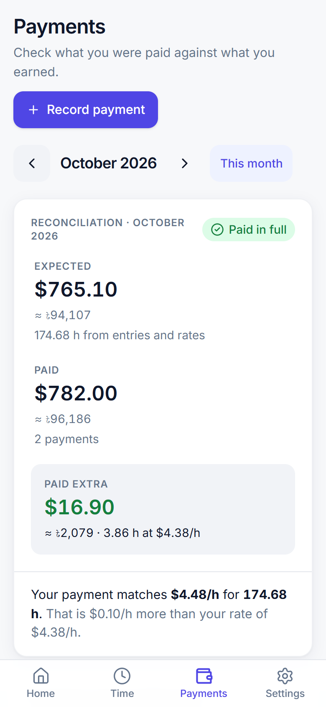

<div align="center">


# Earnings Tracker

**Know what you've earned, at a glance.**<br />
Your real hourly rate, this month's earnings, a month-end projection, and a check of every payment against what you
worked, in USD and your local currency.

[](https://iamshihab2020.github.io/earningcalc/)


[Features](#features) · [How to use](#how-to-use) · [FAQ](#faq) · [Privacy](#privacy) · [Development](#development)

<picture>
  <source media="(prefers-color-scheme: dark)" srcset="docs/screenshots/dashboard-dark.png" />
  
</picture>

</div>

## Why

Time trackers like Hubstaff show hours and a total, but not the answers an hourly worker actually needs: *What is my
real rate? Where will I end the month? Was I paid the right amount, and if not, how many hours is the gap?* This app
answers those from the numbers you already have, and gives you a summary you can send your manager.

## Features

**Earnings**
- Paste your tracker's total (for example `118:40:48` and `$519.82`) and get your real hourly rate, worked out exactly
- This month's earnings in USD and your local currency, with progress against the month's target hours
- Ahead/behind pace, based on your working days and daily target

**Time**
- Log a single day, backfill a date range (skips weekends and days off), or enter a tracker total for the month
- Adjustments for corrections, including negative ones
- Accepts `8:30:00`, `8:30`, `8.5` or `8h 30m`
- A tracker total and daily entries for the same days are never counted twice

**Payments**
- Record payments in USD or BDT; each BDT payment keeps the exchange rate it was made at
- Reconciliation per month: expected vs paid, the gap in money *and* hours, and the hourly rate the payment works out to

**Planning**
- Month-end projection that updates as you change hours per day
- What-if situations: where you are now, a heavy stretch, stop after tomorrow, keep going, a standard month
- Mark future days as holidays without changing your schedule
- Offer calculator (`$800` for January at 8 h/day = `$4.76/h`) and side-by-side rate comparison

**Rates and schedule**
- Rate history with changes from a date, from the start of a month, or for a whole month, with a preview of what changes
- Working days, daily target, holidays and days off

**Sharing**
- A Slack-ready summary with the questions to ask about any gap, editable before you copy it
- CSV export, JSON backup, and a printable monthly statement (print to PDF)

**App**
- Installable on phone and desktop, works offline
- Light and dark themes, built for 360 px phones up to wide screens
- Undo on every delete and replace

<table>
  <tr>
    <td></td>
    <td></td>
    <td></td>
  </tr>
</table>

## How to use

Open **https://iamshihab2020.github.io/earningcalc/**. Want to look around first? Tap **Load sample data** on the
welcome screen, then remove it later with **Settings → Data → Delete all data**.

1. **Set your rate.** Tap **Enter tracker total** and paste the time and amount from your tracker's schedule card. The
   app suggests the rate that reproduces that total. Or tap **Set hourly rate** and type it in.
2. **Check your schedule.** In **Rate & schedule**, set your working days and daily target (default Mon–Fri, 8 h), and
   mark holidays and days off.
3. **Log time.** Tap **Add time**:
   - **Single**: one day's hours, with a type (*Tracked*, *Backfill* or *Adjustment*) and a note
   - **Backfill**: hours your manager added for a date range; days off are skipped
   - **Tracker total**: the month's total from your tracker; a newer reading replaces the old one
4. **Record payments.** In **Payments**, tap **Record payment** and choose which month it pays for. The month shows
   *Paid in full*, *Short by $…* (with the gap in hours) or *No payment recorded*.
5. **Plan the month.** The dashboard shows where you'll finish at your current hours per day. **What-if** lets you try
   other situations, and work out what a monthly offer is worth per hour.
6. **Share.** **Share & export** has a summary message to copy into Slack, a CSV of the month, and a printable
   statement.
7. **Back up.** **Settings → Data → Export backup** now and then. It's the only copy outside your browser.

**Install it as an app:** on Android or desktop Chrome/Edge, use **Install app** in the browser menu (or the install
icon in the address bar). On iPhone, open it in Safari, tap **Share → Add to Home Screen**.

## FAQ

<details>
<summary><b>Where is my data stored?</b></summary>

In your browser's `localStorage`, on the device you're using. There is no server and no account. Nothing you enter is
sent anywhere.
</details>

<details>
<summary><b>Can I use it on my phone and my laptop?</b></summary>

Yes, but each browser keeps its own copy. Move your data with **Settings → Data → Export backup** on one device and
**Import backup** on the other. Import replaces what's there (and can be undone).
</details>

<details>
<summary><b>Can I lose my data?</b></summary>

Clearing your browser's site data, or using a private window, removes it. The app asks the browser to keep its storage,
but export a backup regularly to be safe.
</details>

<details>
<summary><b>Does it work offline?</b></summary>

Yes. After the first visit the whole app is cached, so it opens and works without a connection. Only **Fetch latest
exchange rate** needs the internet.
</details>

<details>
<summary><b>I entered a tracker total and daily entries. Are hours counted twice?</b></summary>

No. Tracked entries on days inside the tracker total's date range are shown but not counted again (they're marked
*In tracker total, not counted again*). Backfill and adjustments always count, because the tracker doesn't know about
them.
</details>

<details>
<summary><b>Why does it say I'm "behind" when I've worked full days?</b></summary>

By default, **Count today as worked** is on: the app assumes today's hours are already in your total, and counts
remaining days from tomorrow. If you entered your total in the morning before working, turn it off (on the dashboard or
in Settings), and today counts as a remaining day.
</details>

<details>
<summary><b>My rate changed in the middle of a month.</b></summary>

In **Rate & schedule**, tap **Change rate** and pick an effective date. You'll see what changes before you apply it.
Days before that date keep the old rate. A tracker total that spans both rates is split by working days.
</details>

<details>
<summary><b>Where does the exchange rate come from?</b></summary>

You set it in **Settings → Currency** (default ৳123 per $1). **Fetch latest exchange rate** gets today's rate from
[open.er-api.com](https://www.exchangerate-api.com/docs/free). The request contains no information about you.
</details>

<details>
<summary><b>I deleted something by mistake.</b></summary>

Every delete or replace shows an **Undo** button for 7 seconds. After that, restore from a backup.
</details>

## Privacy

- No account, no analytics, no cookies, no server. The app is static files on GitHub Pages.
- Your entries live only in your browser's `localStorage` (key `earnings-tracker:v1`).
- The only network request the app makes on its own is loading itself. Fonts and icons are bundled.
- **Fetch latest exchange rate** calls open.er-api.com, and only when you tap it.
- All of one account's GitHub Pages sites share the origin `iamshihab2020.github.io`, so they can technically read each
  other's `localStorage`.

## Development

Needs Node 22 or newer.

```bash
npm install
npm run dev          # http://localhost:5173
```

| Command | What it does |
|---|---|
| `npm test` | Engine unit tests: every PRD worked example, to the cent |
| `npm run e2e` | Playwright flows for the acceptance criteria, desktop and 360 px phone (uses installed Chrome) |
| `npm run typecheck` | TypeScript, strict |
| `npm run build` | Production build with service worker |
| `npm run screenshots` | Retake the README screenshots from sample data (dev server must be running) |
| `npm run deploy` | Tests, builds, and publishes to GitHub Pages |

**Stack:** React 19, TypeScript, Vite, Tailwind CSS 4, Zustand, Radix UI, wouter (hash routing), vite-plugin-pwa,
Vitest, Playwright.

### Project structure

```
src/
  engine/       Pure calculation module, no React. Money in integer cents, rates in 1/10,000 USD,
                dates as YYYY-MM-DD strings. The UI only displays what this returns.
  store/        Zustand store persisted to localStorage, with undo for every destructive action
  features/     Screens: dashboard, time, payments, rates, what-if, share, settings
  components/   Shared UI (buttons, cards, sheets, month selector)
e2e/            Playwright flows
scripts/        deploy-pages.mjs, screenshots.mjs
docs/           README screenshots
```

### Deploy

Live at https://iamshihab2020.github.io/earningcalc/. Pages serves the `gh-pages` branch. To publish the current
commit:

```bash
npm run deploy       # refuses if you have uncommitted changes
```

It runs the tests, builds with `BASE_PATH=/earningcalc/`, and force-pushes `dist/` to `gh-pages`.
`.github/workflows/deploy.yml` does the same with GitHub Actions; it's manual-only while Actions is unavailable on this
account.

### Design decisions

Where the product spec was silent or contradicted itself:

| Topic | Decision |
|---|---|
| Tracker total vs daily entries | One tracker total per month. Tracked entries inside its date range are shown but not counted again; backfill and adjustments always count. |
| Tracker vs app figure | The tracker's earned figure counts by default. If the app's calculation differs, both are shown and you can switch. |
| Derived rate precision | Suggest the shortest rate (2, then 3, then 4 decimals) that reproduces the tracker's total exactly. |
| Rate change modes | "From start of month" adds a rate on the 1st; "whole month" also removes other changes inside that month, keeping later months' rates. |
| Dates before the first rate | The earliest rate also covers them. |
| BDT payments | Store the exchange rate used, so later rate changes don't alter past reconciliations. |
| Today in projections | Remaining days start tomorrow ("Count today as worked" on). The spec's worked example 2 assumes it off. |

### Not built yet

Charts, sync between devices, swipe gestures on mobile, pre-filled Bangladesh public holidays, PNG icons for older iOS.
